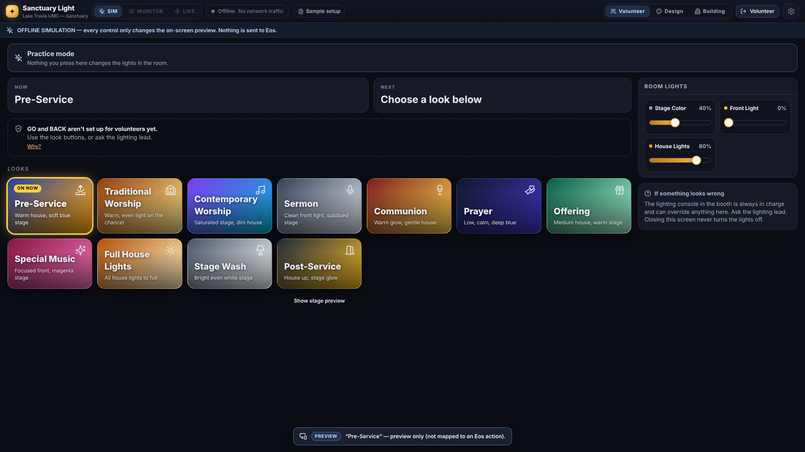
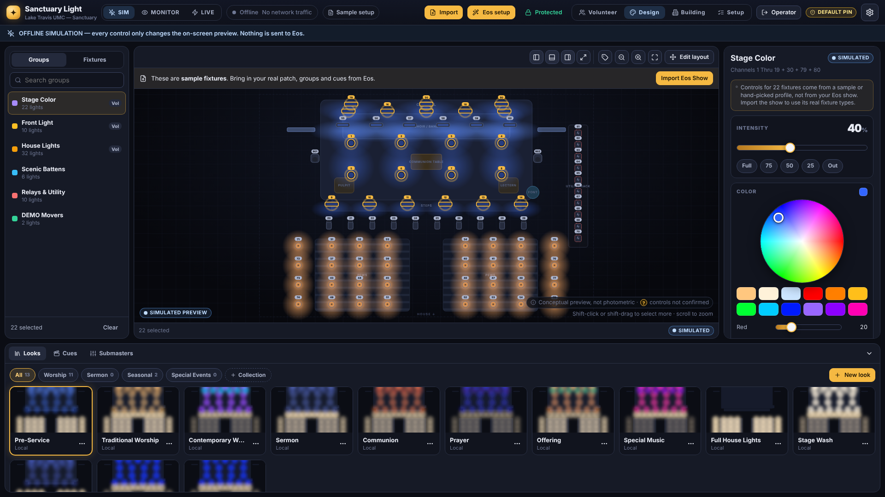

# Sanctuary Light

A Lightkey-inspired visual lighting controller for **Lake Travis United Methodist Church**. It drives **ETC Eos** over ETC's documented OSC interface. The primary deployment is the sanctuary **Windows 11 PC**, where it runs **next to ETCnomad** and connects over localhost. An Eos console such as the Ion also works.

```
                        ┌────────────────── sanctuary Windows 11 PC ──────────────────┐
Edge app window  ⇄  Sanctuary Light server  ⇄  OSC (TCP, 127.0.0.1)  ⇄  ETC Eos / ETCnomad  ⇄ USB ⇄ Gadget II ⇄ wireless DMX / DMX lines
 (React UI)          HTTP + WebSocket,                                     owns show file, patch,
                     safety rules                                          cues and all DMX output
                        └─────────────────────────────────────────────────────────────┘
```

Eos stays the lighting engine and the fallback. Sanctuary Light sends it commands such as "Chan 21 Thru 29 At 75" or "fire cue 1/6", using the same syntax an operator types. **It never sends DMX, sACN or Art-Net itself**, so the Gadget II, the wireless DMX and SceneStation see exactly what Eos sends today.

| Volunteer mode | Operator mode |
|---|---|
|  |  |

> **Status: Phase 3.2 (Windows 11 primary deployment next to ETCnomad). Tested only against a *fake* Eos console**, with CI on Windows (x64), Linux and Apple Silicon macOS.
> The app has **not** been connected to the real Eos system yet. On-site commissioning uses the built-in **Eos Setup Wizard**; see [`docs/START_HERE.md`](docs/START_HERE.md) and [`docs/COMMISSIONING.md`](docs/COMMISSIONING.md). The sample patch, groups, looks and cue labels are placeholders built from the preliminary channel groupings. Nothing in them has been checked against the real show file.

---

## Quick start

Requirements: **Node.js 20.19+** (22 LTS recommended) on the control computer.

```bash
npm install
npm start            # builds the UI and starts the server
```

Open **http://localhost:4700**. The app always starts in **Offline Simulation**.

Default PINs: **operator `1234`**, **volunteer `0000`**. Change them in *Settings → Safety & Security* before any live use. A badge appears until you do.

### On the sanctuary Windows PC (primary; no Terminal for volunteers)

```powershell
git clone https://github.com/isaiahlcasillas-sys/sanctuary-light C:\SanctuaryLight
# then double-click C:\SanctuaryLight\deploy\windows\Install Sanctuary Light.cmd
```

The installer builds and tests the app, registers a hidden **start-at-sign-in** scheduled task with a crash-restarting supervisor, keeps the PC awake while it runs, and adds a **Sanctuary Light** desktop icon that opens an Edge app window. It **always starts in Offline Simulation** and never touches Eos, the show file, the Gadget II or the wireless DMX. See [`docs/INSTALL_WINDOWS.md`](docs/INSTALL_WINDOWS.md) and [`docs/WINDOWS_DEPLOYMENT.md`](docs/WINDOWS_DEPLOYMENT.md).

### On a Mac (secondary)

```bash
./deploy/macos/install.sh       # one time: builds, tests, installs a login service + "Sanctuary Light.app"
```

The service starts at login, restarts after a crash, keeps the Mac awake, and makes a daily config backup. It **always starts in Offline Simulation**. See [`docs/MAC_DEPLOYMENT.md`](docs/MAC_DEPLOYMENT.md).

### Development (hot reload)

```bash
npm run dev          # server on :4700 (auto-restart) + UI on http://localhost:5173
npm test             # ~100 tests: OSC codec/framing, Eos commands, version rules, group safety, wizard guards, recovery, patch import
npm run typecheck
```

### Trying the full stack without Eos

```bash
npm run eos-sim                         # FAKE Eos 3.3 console: TCP 3032 (OSC 1.0), 3037 (SLIP), UDP 8000→8001
npm run eos-sim -- --version 2.9.3      # behaves like Eos 2.9: no port 3037, no /eos/cues
```

Then sign in as operator, open **Eos setup**, enter the version you started the simulator with, choose **Eos runs on this computer** (127.0.0.1), and walk through the Monitor and Live-test steps. The fake console prints every OSC message it receives, so you see exactly what the real Eos would get. It labels itself "FAKE SHOW (not a real console)", so it can't be mistaken for real feedback.

> **Never run the fake console on the sanctuary PC.** It uses Eos's own ports, so it could stop ETCnomad from opening them. On Windows it refuses to start unless you add `--not-the-sanctuary-pc`.

### Configuration

| Item | Where |
|---|---|
| Data (layout, patch, looks, settings) | `data/config.json`. Override with `SANCTUARY_DATA_DIR`. |
| Automatic backups (last 50) | `data/backups/` |
| PIN hashes | `data/auth.json` |
| Port / bind address | `PORT` (default 4700), `HOST`. By default the server binds to localhost only; see *Settings → Safety* to allow tablets on the LAN. |
| Example patch CSV | [`config/example-patch.csv`](config/example-patch.csv) |

---

## Interface modes

* **Volunteer**: big worship looks, GO/BACK, approved house lights.
* **Worship**: full visual control through Eos (operator PIN).
* **Architectural Status**: how the SceneStation wall stations relate to Eos, from the physical audit. **Read-only: Sanctuary Light does not control SceneStation.**

Looks are labelled **Local look · preview only** (stored in Sanctuary Light) or **Eos · Cue 1/5** (plays show-file data). Nothing in Sanctuary Light writes to the Eos show file.

## Documentation

**New to Sanctuary Light? Start with [`docs/START_HERE.md`](docs/START_HERE.md).**

| Document | Contents |
|---|---|
| [`docs/START_HERE.md`](docs/START_HERE.md) | Hardware-testing roadmap for the Technical Arts Director |
| [`docs/INSTALL_WINDOWS.md`](docs/INSTALL_WINDOWS.md) | Step-by-step Windows 11 install next to ETCnomad, update, uninstall, restore, troubleshooting |
| [`docs/WINDOWS_DEPLOYMENT.md`](docs/WINDOWS_DEPLOYMENT.md) | Same-PC architecture, startup and recovery, failure modes, what's verified |
| [`docs/INSTALL_MAC.md`](docs/INSTALL_MAC.md) | Step-by-step Mac install (secondary option) |
| [`docs/ONSITE_CHECKLIST.md`](docs/ONSITE_CHECKLIST.md) | Gathering the real patch, Eos version, Gadget II / wireless DMX, fixtures, SceneStation info |
| [`docs/FIRST_DAY_TESTING.md`](docs/FIRST_DAY_TESTING.md) | SIM → MONITOR → one authorized live test |
| [`docs/SCENESTATION_WORKSHEET.md`](docs/SCENESTATION_WORKSHEET.md) | House lights, console priority, gateways, fallback scenarios |
| [`docs/SUNDAY_READINESS.md`](docs/SUNDAY_READINESS.md) | PINs, network security, connection recovery, go / no-go |
| [`docs/MAC_DEPLOYMENT.md`](docs/MAC_DEPLOYMENT.md) | Mac setup, startup and recovery behaviour, backups |
| [`docs/COMMISSIONING.md`](docs/COMMISSIONING.md) | On-site Eos Setup Wizard and checks |
| [`docs/SYSTEM_AUDIT.md`](docs/SYSTEM_AUDIT.md) | Physical audit questionnaire: Eos PC/console, nodes, SceneStation, DMX lines, failure tests |
| [`docs/SCENESTATION.md`](docs/SCENESTATION.md) | SceneStation research: documented behaviour vs. unknowns, integration options |
| [`docs/ARCHITECTURE.md`](docs/ARCHITECTURE.md) | System architecture, safety invariants, local vs show-file data |
| [`docs/ROADMAP.md`](docs/ROADMAP.md) | Realistic implementation plan |
| [`docs/EOS_OSC.md`](docs/EOS_OSC.md) | Eos OSC commands, ports by version, group safety |

## Engine modes (SIM / MONITOR / LIVE)

The modes are mutually exclusive. Only one output engine can exist at a time (`server/src/engine/`).

| Mode | Network traffic | Lighting commands |
|---|---|---|
| **SIM**: Offline Simulation (startup default) | none | Preview only. Every toast says "Nothing was sent". |
| **MONITOR**: Eos Monitor | OSC connection; only `/eos/ping`, `/eos/get/*` and `/eos/subscribe` are allowed | Blocked, both in the controller and again at the transmit layer |
| **LIVE**: Eos Live Control | OSC commands to Eos | Sent. Requires an operator PIN and an explicit "Arm" confirmation. |
| **DMX**: Direct sACN/Art-Net | — | **Not implemented** (Phase 5). The button is disabled and the engine refuses to start. |

Every command returns one of `sent`, `simulated`, `blocked` or `error`, and the UI shows it. **No button silently changes only the preview.** For example, a look with no Eos action says *"not mapped — only the on-screen preview changed"*, even in Live mode.

### What is confirmed and what isn't

* **Cue feedback**: the active cue, pending cue and fade progress come from `/eos/out/active|pending/cue/...`. They are shown with a green **CONSOLE** badge.
* **Channel levels are never claimed as confirmed.** Eos OSC does not give third-party apps a stream of every channel's level. Faders show **SIMULATED** (offline) or **COMMANDED** (sent, unconfirmed).
* **Submaster positions** are commanded only. If someone moves a fader in Eos, this app won't know.
* **Stale feedback:** a heartbeat (`/eos/ping`) runs every 3 s. If no reply arrives for 10 s, a yellow STALE banner appears.

## Safety design

* The app starts offline, and live mode is never restored automatically after a restart.
* **Nothing is sent** when you disconnect, change mode, lose the network or close the app. There is no blackout and no "release". Eos keeps its state.
* **Protected channels**: relays and utility (61–70 by default) are refused until an operator unlocks them. The unlock is time-limited (5 min), and it applies in every mode. Protected submasters work the same way.
* Volunteers can only fire volunteer-visible looks, GO/BACK, fire cues, and adjust volunteer-visible groups and submasters.
* Fader updates are rate-limited (10/s by default, latest value wins), so Eos's command line is never flooded.
* Use a dedicated **OSC user** (*Settings → Connection*). Command-line commands then go to `/eos/user/<n>/...` and never type into the operator's command line in Eos.
* **Connecting requires a confirmed Eos version.** Ports and features are checked against it, so the app refuses TCP 3037 before Eos 3.1, for example. See [`docs/EOS_OSC.md`](docs/EOS_OSC.md).
* **Local groups are never trusted as proof of what an Eos group contains.** "Group N" is sent only after the console has reported, this session, that the group exactly matches and contains no protected channel. Otherwise the explicit local channel list is sent. Preset looks are blocked until their group is verified, and macro looks are operator-only.
* **Stale connections refuse commands.** If Eos hasn't answered within the stale time, Live commands are refused, not queued, so nothing can be delivered late after a network blip. A TCP connection that goes silent is dropped and reopened automatically.
* **GO/BACK target the configured cue list** (`/eos/cues/<list>/fire|stop`) in Eos 3.3+, where ETC documents it. Older versions fall back to the `go_0`/`stopback` keys, and the UI flags that these act on the master playback.
* SceneStation and architectural zones are not in this app's patch. Keep it that way unless Eos already controls them.
* Saving layouts, patch, looks and cue labels writes local JSON only. **No setting in this app modifies the Eos show file.** Destructive operations (replace patch, restore, reset) ask for confirmation and back up first.
* The WebSocket rejects cross-site origins. Every command is re-authorised against its session token.

---

## Project structure

```
shared/src/        Types shared by server and UI (model, WebSocket protocol, channel-list helpers)
server/src/
  index.ts         Express + WebSocket server, REST API, static UI hosting
  controller.ts    The control backend: roles, safety rules, simulation, mode switching, feedback
  auth.ts          PIN login (scrypt hashes), session tokens
  osc/             OSC 1.0 codec, UDP/TCP links, SLIP + length-prefix framing
  engine/          eosCommands (documented OSC builders), eosFeedback (parser),
                   eosOscEngine (connection/heartbeat/reconnect), directDmxEngine (Phase 5 stub)
  store/           JSON persistence + backups, validation, sample LTUMC config, CSV/JSON patch import/export
server/tools/      fake-eos.ts — development console simulator
server/test/       Vitest suites (includes end-to-end tests against the fake console over TCP)
web/src/           React + TypeScript UI (Radix UI primitives, Zustand, lucide icons)
docs/              EOS_OSC.md (implemented commands + Eos setup), PHASE5_DIRECT_DMX.md
```

## Patch import

*Settings → Patch → Import CSV/JSON* parses the file and shows a preview with warnings. You then choose **Merge** or **Replace**. Columns: `channel` (required; the **Eos channel number, not the DMX address**), `label`, `profile`, `universe`, `address` or `dmx` ("2/101" or absolute 613), `area`, `protected`, `x`, `y`, `rotation`, `notes`. Existing stage positions are kept by channel number.

On Eos 2.0+ you can also use *Settings → Connection → Read patch & cues from console*. It runs read-only `/eos/get/patch` and `/eos/get/cue` queries. The results are shown for review before anything is merged.

## Roadmap

1. **Phase 1, visual prototype** ✅: stage editor, simulated beams, faders, color wheel, CCT, pan/tilt, beam, looks, cues, volunteer mode.
2. **Phase 2, real ETC integration** ✅ *(code complete; awaiting on-site verification)*: OSC over UDP / TCP 1.0 / TCP 1.1, monitor and live modes, cue feedback, connection testing.
   **Phase 2.5, reliability and integration** ✅: version-aware port rules (corrected 3032/3037 guidance), cue-list GO/BACK, group verification against the console, config migration, and the Ion Setup Wizard. Next step: [`docs/COMMISSIONING.md`](docs/COMMISSIONING.md) at church.
   **Phase 3.2, Windows 11 primary deployment** ✅ *(CI-verified on Windows; awaiting the sanctuary PC)*: same-PC loopback OSC to ETCnomad, Windows installer, start-at-sign-in supervisor with crash recovery, desktop launcher, read-only health check. See [`docs/WINDOWS_DEPLOYMENT.md`](docs/WINDOWS_DEPLOYMENT.md).
3. **Phase 3, real sanctuary configuration**: import the actual Eos patch, set Eos group numbers, map looks to real cues and presets, and draw the real room.
4. **Phase 4, volunteer and worship features**: per-service run sheets, look editing for worship leaders, more volunteer polish.
5. **Phase 5, optional direct DMX**: see [`docs/PHASE5_DIRECT_DMX.md`](docs/PHASE5_DIRECT_DMX.md).
