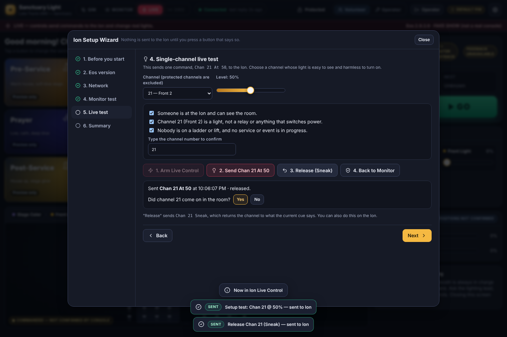

# Commissioning on the real Eos

Do this at church, outside service times, with one person in Eos and one at the Sanctuary Light computer. Nothing in this repository has connected to the real console yet.

## 1. Eos Setup Wizard (in the app)

Sign in as operator. Then use **Eos setup** in the top bar, or *Settings → Connection → Eos Setup Wizard*.

| Step | What happens | Sends to Eos |
|---|---|---|
| Before you start | Safety briefing | nothing |
| Eos version | Type the version from *Browser → Help → About* and confirm you read it on the console. The app picks the right port and framing. | nothing |
| Network | Enter Eos IP. The app lists this computer's interfaces and checks they share a subnet. Tick the version-specific console steps. | nothing |
| Monitor test | Connect read-only, ping, read the version and show name, and optionally verify Eos groups | `/eos/ping`, `/eos/get/version`, `/eos/subscribe 1`, `/eos/get/group/<n>` only |
| Live test | Choose one **non-protected** channel and a level, tick three acknowledgements, and **type the channel number**. Then press *Arm Live Control* and *Send Chan N At L* (two separate buttons), confirm whether the light came on, and *Release (Sneak)* | `Chan N At L #`, then `Chan N Sneak #` |
| Summary | Records results and notes in `data/config.json` (`settings.commissioning`) | nothing |

The live test is refused unless all of these hold: the app is in Live mode, the console is connected and not stale, the typed channel matches, the channel is in the local patch and not protected, and (if the console patch was read this session) the channel exists on the console.

Results are recorded automatically: the monitor test outcome and reply time, the reported version, the channel and level of the live test, and whether it was released.

## 2. Remaining checks (manual, still outside service times)

1. **Cue feedback:** in Eos, press GO on a harmless cue. The *Current* card should update with a green CONSOLE badge.
2. **GO/BACK:** see which method the cue panel shows.
   * *Cue list* (`/eos/cues/<list>/fire|stop`): GO should advance the configured list even when another list is on the master fader.
   * *Keys* (`go_0` / `stopback`): GO acts on the master playback. Confirm that's the list you expect.
   * On Eos 3.0–3.2, test the cue-list method only by choosing it explicitly, then record the result in the wizard notes.
3. **Groups:** enter Eos group numbers in *Settings → Groups*, then press *Verify against console*. Every group should read `verified`. Investigate any group showing `protected` or `mismatch` in Eos. The app keeps working in the meantime, using explicit channel lists.
4. **Submaster:** move one submaster from the app and confirm in Eos.
5. **Color:** change one LED fixture's color. If nothing happens, correct the profile's Eos parameter names.
6. **Relay lock:** try relay channel 61. It must be **blocked** until unlocked.
7. **Disconnect:** switch to SIM. Eos output must not change.
8. **Change PINs** (*Settings → Safety & Security*).

Write anything unexpected in the wizard's notes, such as a changed port, key name or parameter name.

