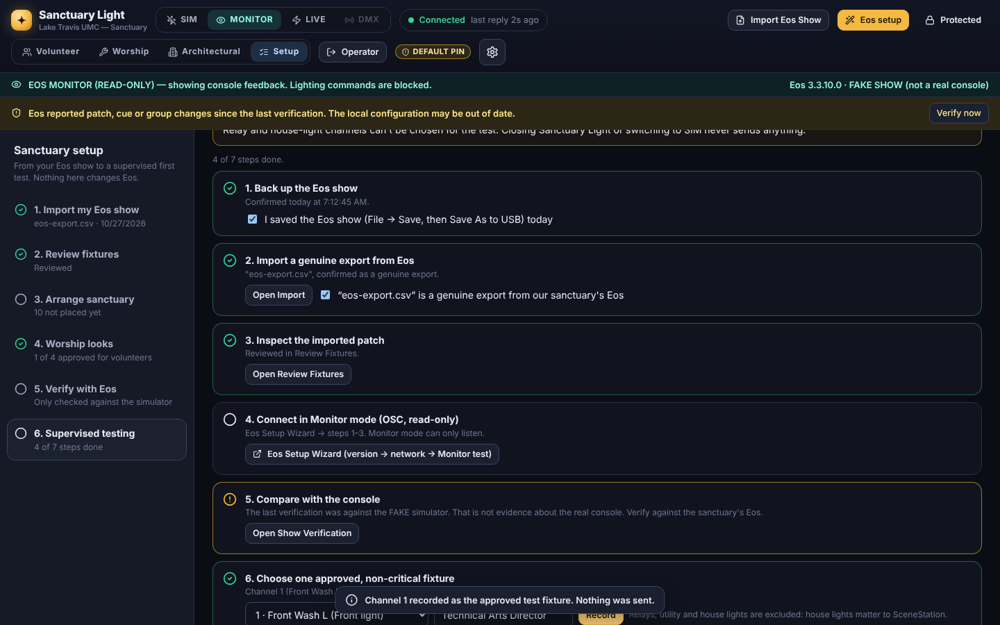

# First Real Connection (the sanctuary's Windows 11 PC)

*Setup → 6. Supervised testing. Plan about 2 hours on a weekday, outside worship, events and rehearsals.*

**People:**
- **Operator:** at Sanctuary Light.
- **Console person:** at Eos, who can override anything.
- **Room observer:** watching the lights, including the house lights.

**Safety for the whole session:**
- Sanctuary Light never stops Eos, never changes DMX output, and never touches SceneStation, the Gadget II or the wireless DMX.
- Nothing on the checklist sends a lighting command. The single live command happens only in step 7, in the Eos Setup Wizard, after three acknowledgements and typing the channel number.
- Switching to SIM or closing Sanctuary Light never sends anything.

**Stop rule:** if anything unexpected happens, the console person takes over in Eos as normal, and the operator clicks **SIM**.

| # | Step | How | Done when |
|---|---|---|---|
| 1 | **Back up the Eos show** | In Eos: *File → Save*, then *File → Save As* to a USB stick. Then tick *I saved the Eos show… today*. | Ticked today |
| 2 | **Import a genuine export from Eos** | *File → Export → CSV* from the loaded show, then Setup → Import (choose **Replace** the first time). Tick *…is a genuine export from our sanctuary's Eos*. | Confirmed for the current import |
| 3 | **Inspect the imported patch** | Setup → Review fixtures: go through the flags, fix categories and names, then tick *I've reviewed…* | Reviewed after the latest import |
| 4 | **Connect in Monitor mode** | Eos Setup Wizard: version → network (choose *On this computer* for ETCnomad on this PC) → Monitor test. Monitor can only listen. | Monitor test passed |
| 5 | **Compare with the console** | Setup → Verify with Eos → **Read from Eos**. Review every difference, then re-import or edit until it matches. | Last complete verification was **against the real console** (not the simulator), after the latest import, with no differences |
| 6 | **Choose one approved, non-critical fixture** | Pick one harmless, visible light and enter who approved it. Relays, utility and house lights can't be chosen; house lights matter to SceneStation. | Recorded |
| 7 | **Supervised live test** | Open the Live test (Eos Setup Wizard). It's pre-set to the chosen channel. Three people present, three acknowledgements, type the channel, arm Live, send **one** command, confirm the light, release it, then back to Monitor and SIM. | Light confirmed and released |

**What counts as evidence.** The automated tests and the FAKE simulator check Sanctuary Light itself, not your system:
- A verification against the simulator is marked as such and doesn't complete step 5.
- A sample file doesn't complete step 2.

Record real results in [TESTING_EVIDENCE.md](TESTING_EVIDENCE.md).

**Live look test (Phase 4B):** below the checklist, the **Live look test** box applies a look designed in Sanctuary Light to the same approved fixture through Eos, and records what the room observer saw. Step-by-step: [LIVE_LOOKS.md](LIVE_LOOKS.md#todays-test-at-the-sanctuary-pc).

**After the test:**
- Keep Sanctuary Light in **Monitor** for a whole service ("shadow Sunday") before any Live use in worship.
- Approve worship looks one by one (Setup → Worship looks), each after watching it in the room.
- Complete [Sunday readiness](SUNDAY_READINESS.md).
