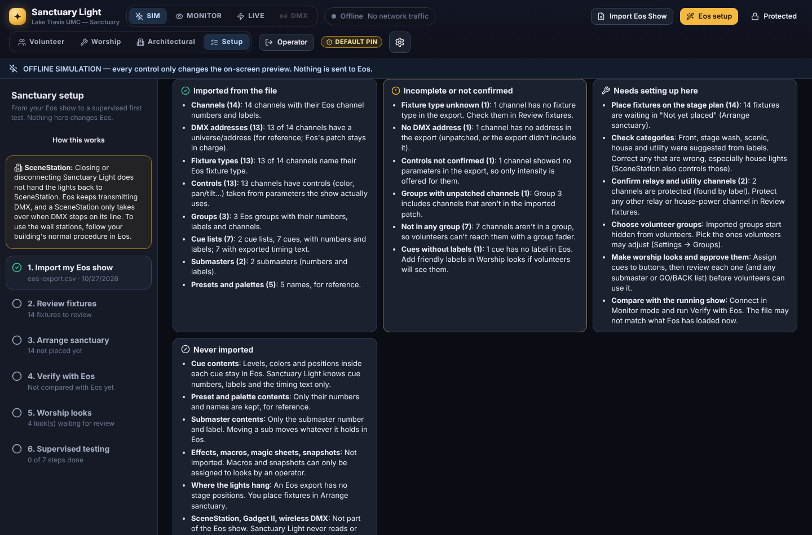
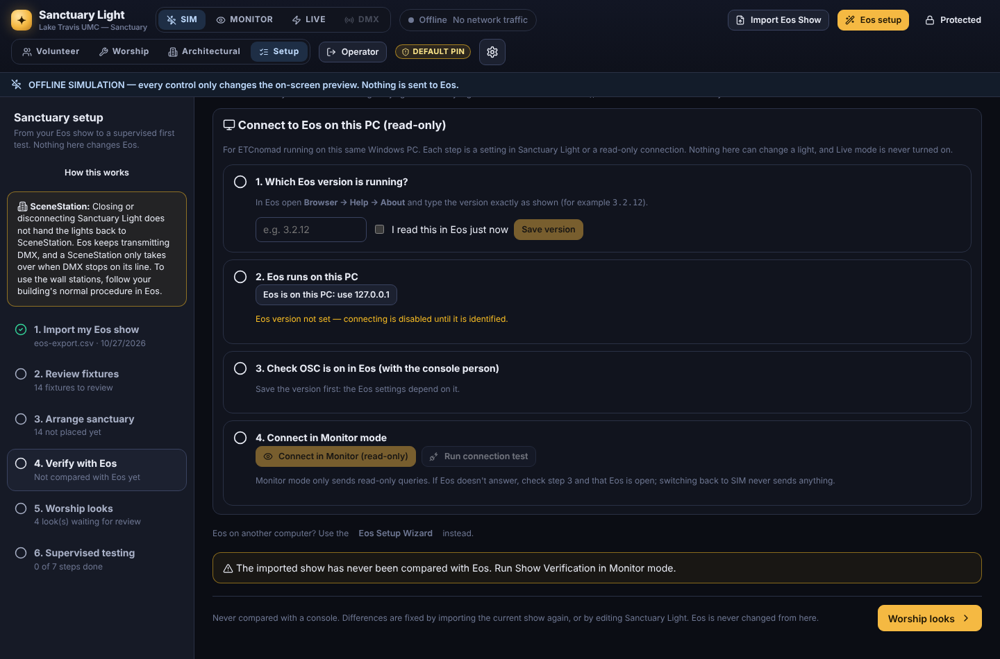
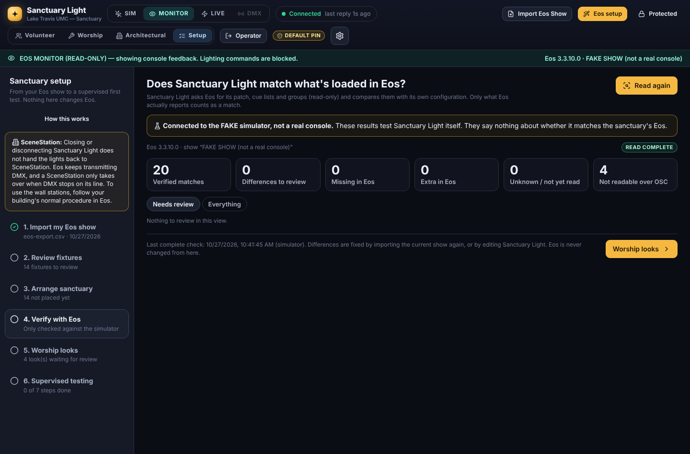

# Installation readiness: Sanctuary Light on the sanctuary Windows 11 PC

*Phase 3.5. For the Technical Arts Director, Lake Travis UMC.*

**Goal for this visit:** Sanctuary Light running on the lighting PC with our **real Eos show**, in **Offline Simulation** and then **Monitor mode**, without changing a single real light.

> **Status: the software is ready to install. Nothing has been tested on our physical lighting system yet.** Every result so far comes from automated tests, sample export files and a simulated ("FAKE") Eos console. See [What has and hasn't been tested](#what-has-and-hasnt-been-tested).

---

## 1. What Sanctuary Light will and won't do on this PC

| Sanctuary Light **will** | Sanctuary Light **will not** |
|---|---|
| Install into `C:\SanctuaryLight`, with settings in `%LOCALAPPDATA%\Sanctuary Light` | Stop, restart or change Eos/ETCnomad, its USB license key, or the show file |
| Add a background task for this Windows user, plus desktop and Start menu icons | Install drivers, need administrator rights, or ask for a restart |
| Start in **Offline Simulation (SIM)** every time, even after a crash or restart | Switch to Monitor or Live by itself |
| In **Monitor** mode, send only read-only queries to Eos (`/eos/get/…`, ping) | Send any lighting command in SIM or Monitor (blocked twice: in the app and at the network layer) |
| Keep the PC awake while it runs | Change the Gadget II, wireless DMX, SceneStation or any DMX output setting |

**SceneStation:** closing or disconnecting Sanctuary Light does **not** hand the lights back to SceneStation. Eos keeps transmitting DMX whether Sanctuary Light is open or not, and a SceneStation only takes over when DMX stops on its line. To give the room back to the wall stations, follow your building's normal procedure in Eos.

**Not part of this visit:** closing Eos, restarting or signing out of the PC, unplugging anything, or Live mode. Each of those waits for the SceneStation audit ([SCENESTATION_WORKSHEET.md](SCENESTATION_WORKSHEET.md)) and the supervised test ([FIRST_REAL_CONNECTION.md](FIRST_REAL_CONNECTION.md)).

---

## 2. Exact Windows installation steps

Full detail: [INSTALL_WINDOWS.md](INSTALL_WINDOWS.md). About 45 minutes, with internet access. Eos stays open throughout.

1. **Back up the show.** In Eos: *File → Save*, then *File → Save As* to a USB stick, named with today's date.
2. **Install Node.js 22 LTS** from nodejs.org (*Windows Installer (.msi), x64*), with the default options. If any installer offers to restart Windows, choose **later**.
3. **Download Sanctuary Light.** Either:
   - GitHub (signed in) → **Code → Download ZIP**, then move the folder inside to `C:\` and rename it `SanctuaryLight`; or
   - Git: `git clone https://github.com/isaiahlcasillas-sys/sanctuary-light C:\SanctuaryLight`.
4. **Install.** Open `C:\SanctuaryLight\deploy\windows` and double-click **`Install Sanctuary Light.cmd`**.
   - It first lists what it will and won't change.
   - Then it checks Windows, Node.js, disk space and its port, and installs the app's parts.
   - It runs the test suite (simulation only; the tests are blocked from Eos's ports) and creates the background task and icons.
   - Wait for **"Installed and running (mode: offline)"**. An `ERROR:` line says what to fix; re-running is safe.
5. **Open** Sanctuary Light from the desktop icon. The **Welcome** screen confirms you're in Offline Simulation. Sign in with the operator PIN **1234**, then change **both** PINs (*Settings → Safety & Security*).
6. **Health check:** double-click **`Check Sanctuary Light.cmd`** (changes nothing). Fix any **[FAIL]**.
7. **Restart test (Sanctuary Light only):** with Sanctuary Light in SIM, double-click **`Restart Test.cmd`**. It stops only Sanctuary Light's own server (identified by its folder) and checks it comes back in **SIM** by itself. Don't end processes in Task Manager, and don't restart the PC.

**If something goes wrong:**

| Message | What to do |
|---|---|
| `Node.js was not found` | Install Node.js 22 LTS (step 2), then open the installer again |
| `The folder is inside OneDrive` | Move the folder to `C:\SanctuaryLight` |
| `Port 4700 is already used by another program` | Run the installer with another port: `install.ps1 -Port 4710` |
| `npm ci failed (internet connection?)` | Check the internet connection and run it again; Eos isn't affected |
| `Tests failed. Nothing was installed.` | Copy the window's text and send it to whoever maintains Sanctuary Light |
| "Sanctuary Light did not start" box | Use Eos directly; then run *Check Sanctuary Light.cmd* and look in `%LOCALAPPDATA%\Sanctuary Light\logs` |

**Uninstalling:** double-click **`Uninstall Sanctuary Light.cmd`**.
- It lists what it removes and asks first. It removes only the background task, the icons and Sanctuary Light's own server process.
- It keeps your settings, and never touches Eos, the USB key, the show, the Gadget II, wireless DMX or SceneStation.
- Windows CI checks that an unrelated program left running is still running afterwards.

---

## 3. Export our real show and import it

Full detail: [IMPORT_EOS_SHOW.md](IMPORT_EOS_SHOW.md).

1. **Export from Eos.** From the show that is loaded, *Browser → File → Export → CSV*: all show aspects, UTF-8 if offered. Exporting writes a new file and doesn't change the show. USITT ASCII also works, with less detail (no fixture types).
   - **Never use File → Open** on this PC to look at another show: it replaces the active show.
2. **Import into Sanctuary Light.** Sign in as operator, then go to **Setup → 1. Import my Eos show → Import Eos Show**. Drop the file in and look through the preview tabs, especially **Issues**.
3. **Choose Replace** (pre-selected and marked *recommended* on the first import), so none of the built-in sample fixtures get mixed in. Relay protections are kept.
4. **Read the import report** on the same screen:
   - **Imported from the file:** each item with a count.
   - **Incomplete or not confirmed:** no fixture type or address, controls not confirmed, unpatched group channels, ungrouped channels, unlabeled cues.
   - **Needs setting up here:** positions, categories, relays, volunteer groups, looks and approvals, verification.
   - **Never imported:** cue, preset and sub contents; effects; macros; positions; SceneStation and DMX hardware.
5. **Tick "This file was exported from our sanctuary's Eos"**, only if it's today's genuine export.

Sanctuary Light never invents fixtures, channel numbers, cue contents or capabilities. A channel the export doesn't describe stays "unknown" or "intensity only", and every imported fixture waits in *Not yet placed* until you put it on the stage plan.

---

## 4. Confirm Sanctuary Light matches what Eos has loaded

Setup → **2. Review fixtures** and **3. Arrange sanctuary** first (offline). Then **4. Verify with Eos**. The **Connect to Eos on this PC** panel walks you through it:

1. **Eos version:** read it in Eos (*Browser → Help → About*) and type it exactly. Sanctuary Light picks the connection for that version: TCP **3037** for Eos 3.1 and later, TCP **3032** before that.
2. **Eos runs on this PC:** one button sets `127.0.0.1`. ETC documents this for Eos **3.2 and later**.
3. **OSC in Eos, with the console person:** the panel lists the exact Eos settings for your version.
   - Write down how they were before, so they can be put back.
   - Change **only** those: not the patch, outputs, Gadget II or DMX.
4. **Connect in Monitor (read-only)**, then **Run connection test**. Eos reports its actual version, and the panel warns if it differs from what you typed.
5. **Read from Eos.** Sanctuary Light reads the patch, cue lists and groups, read-only, and shows:
   - **Verified matches:** label, type and address; cue numbers and labels; group channels.
   - **Differences**, **missing in Eos** and **extra in Eos**. "Missing" is only reported when the read finished.
   - **Unknown:** not read, such as groups the console didn't report.
   - **Not readable over OSC:** sub, preset and palette contents, cue timing, effects, macros. These are never counted as a match.
6. **Fix every difference** by exporting and importing again (or by editing Sanctuary Light), and read again until there are **0 differences and 0 unknown**.
7. **Switch back to SIM** when done. Switching never sends anything.

*Screenshot from the browser test against the FAKE simulator, which is why it says so. Against the real Eos, that warning isn't there.*

If Eos is edited or another show is loaded afterwards, a yellow banner says the configuration may be out of date.

---

## 5. Compatibility limitations (known now)

- **Eos version matters.** Same-PC (`127.0.0.1`) connections are documented for Eos 3.2+. On older versions you may need this PC's own network address. TCP 3037 needs Eos 3.1+. Very old versions use UDP, where groups can't be read back.
- **OSC must be on in Eos.** That's an Eos Show Control setting, changed by the console person. Sanctuary Light can't turn it on.
- **What OSC can't tell us.** Cue, preset, palette and submaster contents, cue timing, effects and macros. Verification marks these "not readable"; approvals are an operator's review, not a verification.
- **File formats.** Only CSV and USITT ASCII exports can be imported. Native `.esf`/`.esf2`/`.esf3d` show files can't. USITT ASCII has no fixture types.
- **Positions and categories.** An Eos export has no stage positions. Categories (front, house…) are suggested from labels and must be checked.
- **GO/BACK for volunteers** needs an approved cue list and an Eos version where GO/BACK can address a cue list directly (otherwise they stay operator-only).
- **Installation needs internet** (to download Node.js and the app's parts) and about 1 GB of disk. There's no offline installer yet.
- **Windows testing so far** is on GitHub's Windows Server runners, not a Windows 11 desktop PC with ETCnomad. The background task's start at sign-in hasn't been observed in CI, because the runner has no interactive sign-in.
- **Windows 10** should work but isn't tested.
- **One copy per PC.** Sanctuary Light uses port 4700 (changeable at install). Eos's OSC ports (3032, 3037, 8000, 8001) are never used for the interface.

---

## 6. What still needs testing at church

None of these has been done. Record results in [TESTING_EVIDENCE.md](TESTING_EVIDENCE.md).

| # | Test | Mode | Risk to lights |
|---|---|---|---|
| 1 | Installer on the real Windows 11 PC, with Eos open and the USB key in. Eos keeps running and the key stays recognised. | SIM | None expected |
| 2 | Background task starts at sign-in on that PC (seen after the next *planned* restart, after the SceneStation audit) | SIM | None |
| 3 | Genuine CSV export of our show imports cleanly; import report reviewed | SIM | None |
| 4 | Monitor connection over `127.0.0.1` to our Eos version | Monitor | None (read-only) |
| 5 | Show Verification against our running show: 0 differences, 0 unknown | Monitor | None (read-only) |
| 6 | Group verification against our Eos groups | Monitor | None (read-only) |
| 7 | Cue feedback: the console person presses GO on a harmless cue in Eos; Sanctuary Light shows it | Monitor | Only what the console person does in Eos |
| 8 | SceneStation audit (worksheet parts A–D, with a qualified person) | — | Scheduled, separate |
| 9 | Supervised single-channel live test | Live | One approved, non-critical light (later) |

---

## 7. Checklist at the lighting computer

Print this page. Tick each box as you go. **Stop at the first surprise**, switch Sanctuary Light to **SIM**, and use Eos as normal.

**Before you start**
- ☐ Outside worship, events and rehearsals
- ☐ Eos is open and working as normal; the USB license key is in
- ☐ Show saved in Eos, and *Save As* to a USB stick with today's date

**Install (no lights involved)**
- ☐ Node.js 22 LTS installed; no restart
- ☐ Sanctuary Light folder is `C:\SanctuaryLight`
- ☐ `Install Sanctuary Light.cmd` → "Installed and running (mode: offline)"
- ☐ Eos still open and working; USB key still recognised
- ☐ Desktop icon opens Sanctuary Light; Welcome screen says **Offline Simulation**
- ☐ Both PINs changed
- ☐ `Check Sanctuary Light.cmd`: no unexpected [FAIL]
- ☐ `Restart Test.cmd` → **PASS** (came back in **SIM**); lights unchanged

**Import (still SIM)**
- ☐ Exported today's show from Eos as CSV (File → Export, not File → Open)
- ☐ Setup → Import → **Replace** → Import
- ☐ Read the import report; noted anything under *Incomplete*
- ☐ Ticked "genuine export from our sanctuary's Eos"
- ☐ Setup → Review fixtures: categories checked (house lights!), relays protected
- ☐ Setup → Arrange sanctuary: fixtures placed, **Save arrangement**

**Monitor (read-only)**
- ☐ Setup → Verify with Eos → version typed from Eos *Help → About* → **Save version**
- ☐ **Eos is on this PC: use 127.0.0.1**
- ☐ With the console person: OSC settings checked or turned on in Eos (old values written down)
- ☐ **Connect in Monitor (read-only)** → banner says **EOS MONITOR (READ-ONLY)**
- ☐ **Run connection test** → Eos replied; the version it reports matches
- ☐ **Read from Eos** → read complete
- ☐ 0 differences, 0 missing, 0 extra, 0 unknown (or each one explained and fixed by re-importing)
- ☐ Console person pressed GO on a harmless cue in Eos → Sanctuary Light showed the cue (optional)
- ☐ Back to **SIM**
- ☐ **No light changed** because of Sanctuary Light at any point today

**Don't today:** Live mode, closing Eos, restarting or signing out of the PC, unplugging anything, or changing SceneStation, Gadget II or wireless DMX settings.

---

## What has and hasn't been tested

| Area | Evidence | Real system? |
|---|---|---|
| App logic, import, verification, volunteer approvals | 169 automated tests, on Windows, macOS and Linux in CI | **No** (sample files, FAKE console) |
| Tests can't reach Eos's ports | Test-suite guard and its own test | **No** (it protects the real PC during install) |
| Installer, supervisor, crash recovery, uninstall leaving other programs running | GitHub Windows Server runner | **No** (not the sanctuary PC) |
| First launch → import → report → same-PC Monitor connection → verification | Chromium browser test against a FAKE Eos 3.3 console on 127.0.0.1; only read-only queries were sent (38 messages: `/eos/get/…`, ping, subscribe) | **No** (simulator) |
| Anything with our Eos, ETCnomad USB key, Gadget II, wireless DMX or SceneStation | — | **Not tested yet** |

**Sanctuary Light has not been tested with our physical lighting system.** Real compatibility is unconfirmed until the tests in section 6 are done and recorded.
