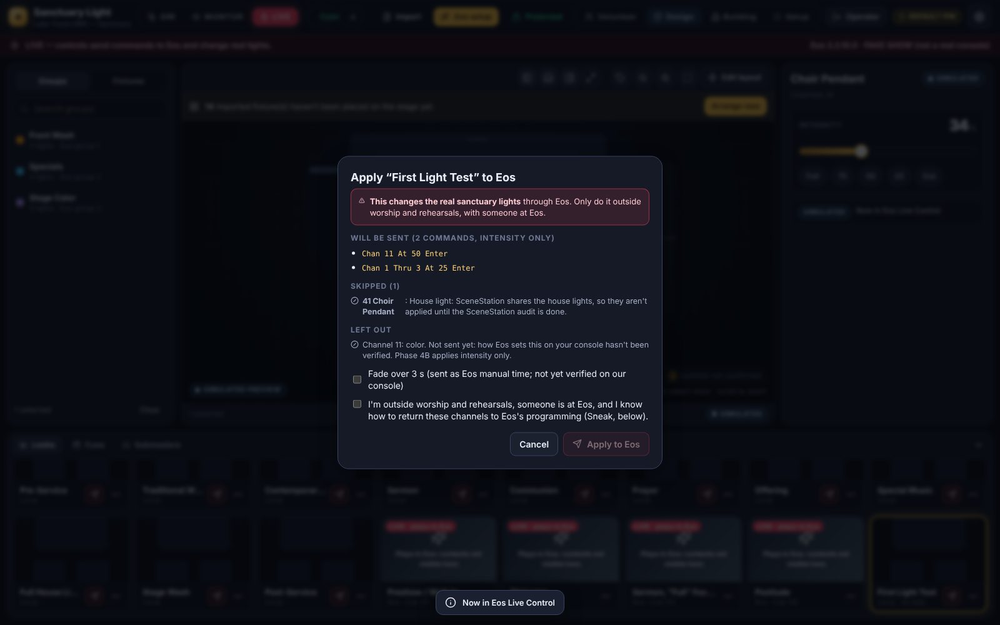
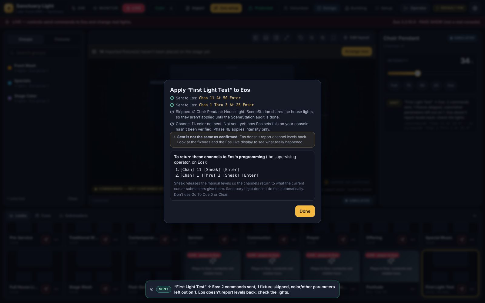
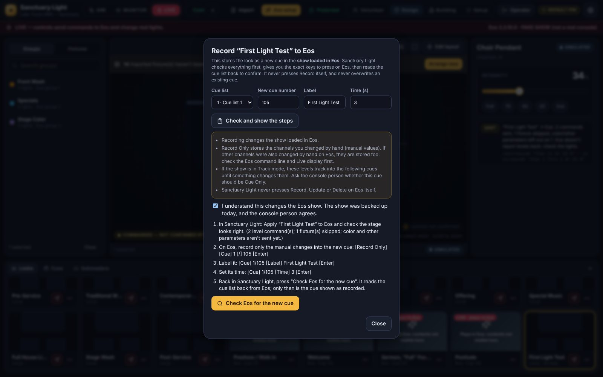
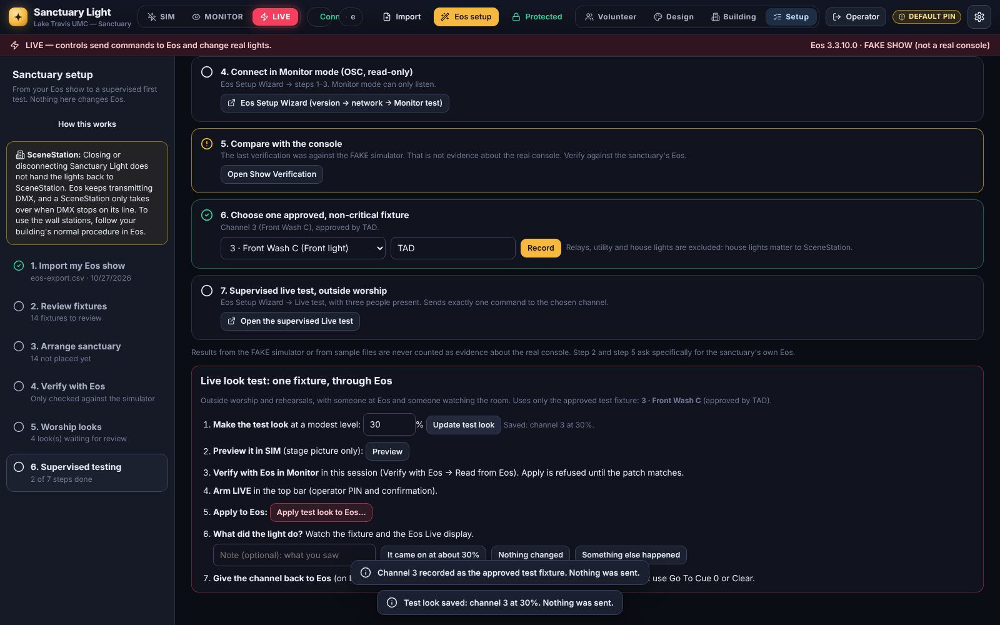

# Live looks: Preview, Apply to Eos, Record to Eos

*Phase 4B. Design a look in Sanctuary Light, then send it to the real sanctuary through Eos.*

> **Status:** works against the FAKE Eos simulator in automated and browser tests. **Not yet tested on our sanctuary system.** Nobody has seen a real fixture respond yet. That is today's test.

## Three different actions

| Action | Where | What it changes | Mode |
|---|---|---|---|
| **Preview** (eye icon: click the look's picture) | Look library | The **stage picture only**. Nothing is sent to Eos. | Any |
| **Apply to Eos** (red send icon on the card, or **⋯ → Apply to Eos…**) | Look library, Supervised testing | The **real lights**, through Eos and the Gadget II / DMX that Eos already drives | **LIVE only**, operator PIN |
| **Record to Eos…** (**⋯ → Record to Eos…**) | Look library | The **show file loaded in Eos**: a new cue | **LIVE only**, operator PIN, backup today |

The top bar and banner always show the mode. A local look's picture says **Preview** in every mode. Looks that play an Eos cue show **LIVE · plays in Eos** while Live is armed.

## Apply to Eos: what it does

1. You design and save a look in SIM (see [LOOK_DESIGNER.md](LOOK_DESIGNER.md)).
2. In LIVE, **Apply to Eos** opens a dialog that shows, before anything is sent:
   - **Will be sent:** the exact Eos command lines, e.g. `Chan 1 Thru 3 At 25 Enter`. Channels are your **imported Eos channel numbers**, always listed directly (never "Group N", so an imported group's membership never matters). Fixtures at the same level share one command.
   - **Skipped**, with the reason:
     - **protected, relay and utility channels:** never applied from a look;
     - **house lights:** SceneStation shares them, so they aren't applied until the SceneStation audit;
     - **channels not in the patch.**
   - **Left out:** color, color temperature, beam and position. **Phase 4B sends intensity only.** How Eos sets those parameters on our console hasn't been verified yet, so they're left out and listed, never guessed.
   - **Fade:** off by default. If ticked, the look's fade is sent as Eos manual time (`… At 25 Time 3 Enter`). **Not yet verified on our console**, so leave it off for the first test.


3. You tick the safety statement and press **Apply to Eos**.
4. The report shows each command as **sent**, **failed** or **not sent** (if Live was switched off or Eos stopped answering part-way, the rest is never sent late).



**Sent is not the same as confirmed.** Eos doesn't report channel levels back over OSC. The stage view marks applied channels **commanded**, not confirmed. Look at the fixtures and the Eos Live display.

### What the server checks before sending anything

Every check is on the server, whatever the screen shows:

- operator PIN (volunteers can never apply a look, and new looks aren't available to them until approved and tested);
- **LIVE** armed, Eos connected and answering (stale → nothing is sent);
- a real show **imported**, and **verified against this console** in Monitor (the FAKE simulator doesn't count for the real console);
- no differences or missing channels in that verification;
- the show loaded in Eos is still the one that was verified, and nothing has changed since;
- the patch was read from Eos **in this session**, and every channel in the look is in it;
- only one Apply at a time; commands are paced 15 ms apart; at most 40 commands per look;
- only the exact shape `Chan … At … [Time …] Enter` can be sent this way.

SIM and MONITOR can never send: Apply refuses, and in Monitor the network layer itself only lets read-only queries out.

### Giving the channels back to Eos

Sanctuary Light does **not** restore levels automatically. The supervising operator does it on Eos, as the report shows:

```
[Chan] 1 [Thru] 3 [Sneak] [Enter]
```

**Sneak** releases the manual levels, so the channels return to what the current cue or submasters give them. Don't use **Go To Cue 0**, **Clear** or a blackout. Then switch Sanctuary Light back to **SIM** (switching never sends anything).

## Record to Eos: operator-assisted, confirmed by read-back

Recording changes the show, and exactly how Record captures manual data, tracking and existing cue data hasn't been verified on our console. So **Sanctuary Light doesn't press Record itself yet**. Instead:

1. **⋯ → Record to Eos…** Choose the cue list, a **new** cue number, a label and a time. Press **Check and show the steps**. The server refuses unless:
   - you're an operator in LIVE;
   - the show is verified, as for Apply;
   - the Eos show was **backed up today** (Setup → Supervised testing → step 1);
   - the cue lists were read from Eos;
   - the cue number is **free**. An existing cue is never overwritten.
2. Tick *"I understand this changes the Eos show…"*. The exact steps appear:
   - **Apply** the look to Eos and check the stage;
   - on Eos: `[Record Only] [Cue] 1 [/] 105 [Enter]` (Record Only stores just the manual changes);
   - `[Cue] 1/105 [Label] … [Enter]`, and `[Cue] 1/105 [Time] … [Enter]` if you set a time.


3. Press **Check Eos for the new cue**. Sanctuary Light reads the cue list back (read-only). It says **"Recorded: confirmed by Eos"** only if Eos reports that cue, and tells you if the label differs or the cue isn't there. The look then shows **Eos cue 1/105**.

Things to agree with the console person first (Sanctuary Light can't see them):
- **Tracking:** in Track mode the new levels track into following cues until something changes them. Decide whether the cue should be Cue Only.
- **Other manual data:** Record Only stores *all* manual changes on the console, including any made on Eos by hand. Check the Live display before recording.
- **Levels can't be read back over OSC:** the read-back confirms the cue exists, its number and label, not its levels.

Pressing Record from Sanctuary Light (with the same checks) is the next step, once this assisted workflow has been proven on our console.

## What's implemented, simulated, unverified or unsupported

| Feature | Status |
|---|---|
| Preview (stage picture, simulated fades in SIM) | Implemented |
| Apply to Eos: intensity, real channel numbers, multiple fixtures, server checks, report | Implemented; **tested only against the FAKE console** |
| Apply to Eos: fade as Eos manual time | Implemented, **unverified** on our console (off by default) |
| Apply to Eos: color, CCT, beam, position | **Not sent** (reported as left out) until verified |
| House lights, relays, protected and utility channels | **Never applied** from a look |
| Confirmation that a light physically changed | **Not possible over OSC**; the operator confirms |
| Record to Eos | **Operator-assisted** with read-back confirmation; Sanctuary Light doesn't press Record yet |
| Automatic restore of previous levels | **Not done** (by design); Sneak on Eos |
| Volunteers applying or recording looks | **Not allowed** |

---

## Today's test at the sanctuary PC

Outside worship and rehearsals. Three people: **operator** (Sanctuary Light), **console person** (at Eos, can override anything), **observer** (watching the room).

### 1. Install or update to the test build

The build to install is the **`phase-4b-live-looks`** branch (pull request #9, which includes Phase 4A).

- **Not installed yet (ZIP):**
  1. On GitHub, switch the branch selector to **`phase-4b-live-looks`**, then **Code → Download ZIP**.
  2. Put the folder at `C:\SanctuaryLight`.
  3. Double-click `deploy\windows\Install Sanctuary Light.cmd`.
- **Already installed from a ZIP:**
  1. Download the ZIP as above.
  2. Delete the old `C:\SanctuaryLight` folder and put the new one in its place. Your settings stay in `%LOCALAPPDATA%`.
  3. Double-click `Install Sanctuary Light.cmd` again.
- **Already installed with Git:** in Terminal:
  ```powershell
  cd C:\SanctuaryLight
  git fetch origin
  git checkout phase-4b-live-looks
  powershell -ExecutionPolicy Bypass -File deploy\windows\update.ps1
  ```
  `update.ps1` refuses unless Sanctuary Light is in SIM, backs up your settings, and rolls back if anything fails.
- **Fresh install with Git:**
  ```powershell
  git clone -b phase-4b-live-looks https://github.com/isaiahlcasillas-sys/sanctuary-light C:\SanctuaryLight
  ```
  Then double-click `deploy\windows\Install Sanctuary Light.cmd`.

The installer runs the test suite (simulation only, blocked from Eos's ports) and ends with **"Installed and running (mode: offline)"**. Don't restart the PC.

### 2. The test

1. **Back up the show:** in Eos, *File → Save*, then *Save As* to USB. Then Setup → Supervised testing → tick step 1.
2. **Import** today's genuine CSV export (Setup → Import → **Replace**). Tick "genuine export".
3. **Connect and verify in Monitor:** Setup → Verify with Eos:
   - version from *Help → About*, **Save version**;
   - **Eos is on this PC: use 127.0.0.1**;
   - with the console person, check the OSC settings;
   - **Connect in Monitor (read-only)**, then **Read from Eos**;
   - aim for **0 differences, 0 missing, 0 unknown**.
4. **Choose one fixture:** Setup → Supervised testing → step 6. Pick **one non-critical, visible stage light** that the console person approves, from **our real patch** (never assume a channel from the sample setup). Enter who approved it.


5. **Make the test look:** in the **Live look test** box, set a modest level (30% is the default, 50% the maximum) and press **Create test look**. Press **Preview** and check the stage picture (nothing is sent).
6. **Arm LIVE** in the top bar (operator PIN, confirmation).
7. **Apply:** press **Apply test look to Eos…**. Read the dialog: it should list exactly one command, e.g. `Chan 12 At 30 Enter`. Tick the statement and press **Apply to Eos**.
8. **Observe:** does that one fixture come on at about the level? Is the Eos Live display showing that channel at 30 (manual, in red or with the manual indicator)? Did anything else change? Record it with **It came on / Nothing changed / Something else happened** and a note.
9. **Restore:** the console person types `[Chan] 12 [Sneak] [Enter]` on Eos. The fixture returns to what Eos's programming gives it. Then switch Sanctuary Light to **SIM**.
10. Write the result in [TESTING_EVIDENCE.md](TESTING_EVIDENCE.md).

**Stop at the first surprise:** the console person takes over on Eos as usual (Sneak, or their normal procedure), and the operator clicks **SIM**.

Not today: house lights, relays, SceneStation, closing Eos, unplugging anything, Record to Eos (unless the console person wants to try the assisted steps on a spare cue number after the Apply test has worked).
