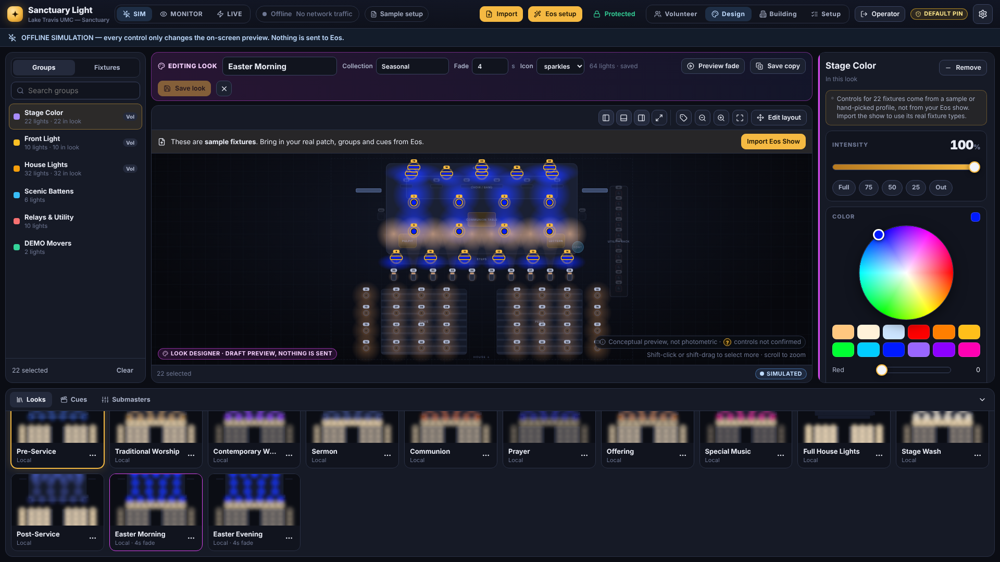
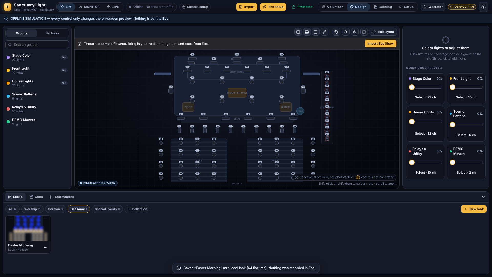

# Design workspace and Look Designer

*Sign in with the operator PIN and press **Design** in the top bar.*

## The workspace

| Area | What it's for |
|---|---|
| **Stage** (middle) | The overhead plan of the sanctuary with a simulated picture of the lights. Click a fixture to select it; shift-click or shift-drag to select more; scroll to zoom; drag to pan. |
| **Browser** (left) | **Groups** and **Fixtures** (sorted by front, stage wash, scenic, house and utility), with search. Clicking here selects on the stage too. `?` means the import couldn't confirm that fixture's controls; a lock means protected. |
| **Inspector** (right) | Controls for whatever is selected: intensity, and color, color temperature, beam or position **only when the selected fixtures are known to support them**. Outside the Look Designer these controls work exactly as before: preview in SIM, read-only in Monitor, real commands in Live (with every safety rule on the server). |
| **Looks · Cues · Submasters** (bottom) | The look library, the cue list and the submasters. Collapse it with the arrow. |
| **Panel buttons** (stage toolbar) | Hide or show the browser, the bottom panel and the inspector. **Full stage** (or the **F** key) hides everything but the stage; **Esc** brings the panels back. Your choice is remembered on this computer. |

The top bar shows the operating mode (SIM / MONITOR / LIVE), the Eos connection, the active show (or "Sample setup"), the protected-channel lock and the views (Volunteer, Design, Building, Setup). On smaller screens the labels shrink to icons; hover for their names.

## Designing a look

The Look Designer works in **Offline Simulation (SIM) only**. Everything you do in it changes a **draft** in your browser. It sends nothing, not even to the simulator, until you save, and saving only writes a **local** look in Sanctuary Light.

1. In the **Looks** tab press **New look** (or, on an existing local look, **⋯ → Edit in Look Designer**).
2. Select lights on the stage or in the browser, then press **Add** in the inspector (adjusting a light also adds it).
3. Set intensity and, where the fixtures support it, color, color temperature, beam or position. Lights that aren't in the look are shown dimmed; when the look plays they keep whatever they had.
4. Name the look, choose or type a **collection** (Worship, Sermon, Seasonal, Special Events, or your own), set the **fade** time and an icon.
5. **Preview fade** shows the draft fading up from dark on the stage.
6. **Save look** (or **Save copy** to keep the original). Close with **✕**; unsaved changes are confirmed first.

Only what each fixture is known to support is stored: a color on a dimmer-only fixture is dropped, and fixtures whose controls the import couldn't confirm only offer intensity.

## The library

- **Play** a look by clicking its picture. In SIM it crossfades over the look's fade time; in Monitor nothing is sent; in Live a local look still only changes the preview (it is never turned into an Eos command).
- **⋯** menu: edit (local looks), duplicate (an Eos look duplicates into a local look you can design), rename, move to another collection, delete (a settings backup is kept).
- Collections filter the library. **+ Collection** starts a new one; it's kept once a look is saved into it.
- Thumbnails are drawn from what a look sets. Looks that play something in Eos show **"Plays in Eos: contents not visible here"** rather than an invented picture.

## What the preview can and can't tell you

The stage is a **conceptual sketch**, not a photometric model of the sanctuary:
- beam sizes, brightness and colors are approximations from the fixture type;
- it doesn't know the real positions, focus, gels, lenses or room surfaces beyond what's been arranged;
- a `?` marks fixtures whose controls the import couldn't confirm (only intensity is offered);
- fixtures from sample or hand-picked profiles say so in the inspector;
- Eos cue, preset and submaster contents are never shown, because Sanctuary Light can't read them.

## Safety

- The Look Designer and simulated fades run in **Offline Simulation only**; Live behaviour is unchanged.
- Saving a look never records anything in Eos, and a local look never becomes a live lighting command. Turning designed looks into Eos cues would need a separately designed, verified and approved workflow (not built).
- Volunteers see a look only if it's marked for volunteers, and looks that play something in Eos still need an operator's approval. The server enforces this.
- Relay, house-light and cue-list protections are unchanged.
