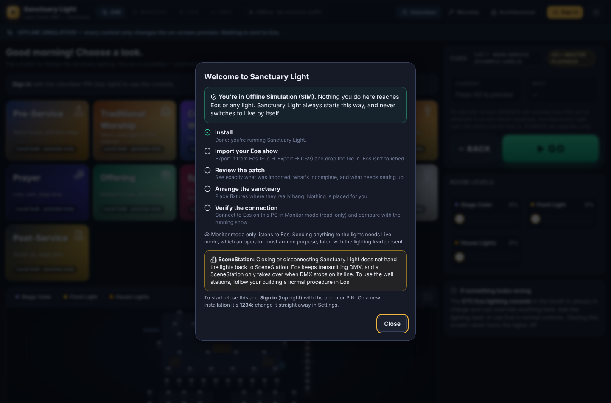
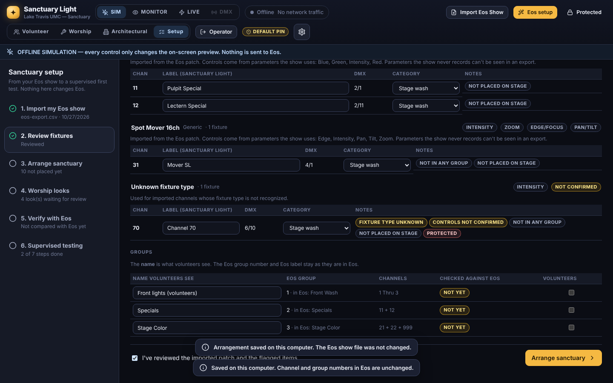
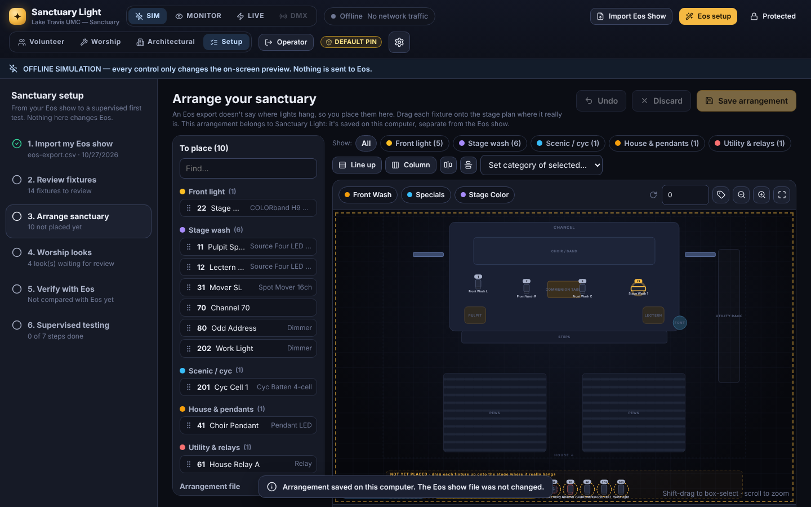
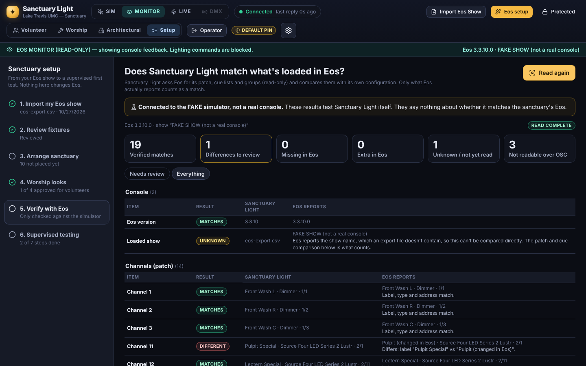
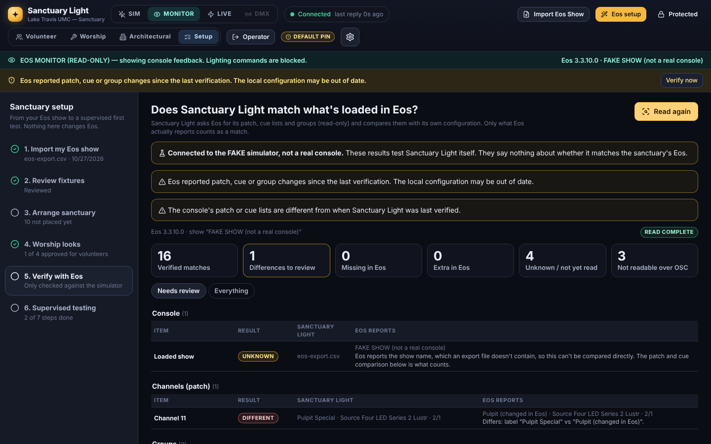
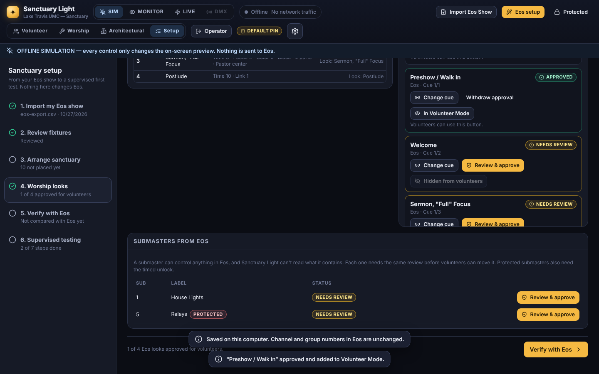

# Sanctuary Setup: from your Eos show to supervised testing

*Open Sanctuary Light, sign in with the operator PIN, and press **Setup** in the top bar.*

**Install Sanctuary Light → Import my Eos show → Review fixtures → Arrange sanctuary → Verify with Eos → Worship looks → Supervised testing.**

The first time Sanctuary Light opens on a computer, a **Welcome** screen explains that it's in Offline Simulation (nothing reaches Eos or the lights) and shows this path. Reopen it with **How this works** on the Setup screen.

The steps are listed on the left with a tick when done. You can stop at any point and come back later. Nothing on these screens changes Eos, the Gadget II, the wireless DMX or SceneStation. Only **Verify with Eos** talks to the console: it reads, in Monitor mode, and only when you press **Read from Eos**.

## 1. Import my Eos show

Export the show that's loaded in Eos (*File → Export → CSV*), then press **Import Eos Show** and drop the file in. Full details: [IMPORT_EOS_SHOW.md](IMPORT_EOS_SHOW.md).

After importing, this screen shows the **import report**: what was imported from the file, what's incomplete or unconfirmed, what needs setting up here, and what is never imported (cue contents, effects, macros, positions, SceneStation).

- **On a first import, choose Replace.** That makes Sanctuary Light's setup match your show instead of mixing it with the built-in samples. Replace never borrows labels, types or positions from the samples. It only keeps protections (relays stay protected).
- **Then tick "This file was exported from our sanctuary's Eos".** Sample and test files are fine for practice, but only a genuine export counts as evidence.
- **Your own copy:** the imported data is Sanctuary Light's own copy, kept separate from the show loaded in Eos. If Eos changes later, Verify with Eos tells you.

## 2. Review fixtures

- **Every channel is listed,** sorted by its **Eos fixture type** and by the **controls** Sanctuary Light will offer (Intensity, Color, Pan/Tilt…). Those controls come only from parameters your show actually uses; nothing is guessed.
- **What the import could not verify** is flagged on each channel:
  - fixture type unknown
  - controls not confirmed
  - no DMX address
  - not in any group
  - not placed yet
  - protected
  - renamed here

  The summary also says plainly when nothing has been compared with the console yet.
- **Rename freely.** Labels and group names here are Sanctuary Light's. The **channel number** and the **Eos group number** never change, and the original Eos label stays visible next to a renamed group.
- **Categories:** set each fixture's category (Front light, Stage wash, Scenic / cyc, House & pendants, Utility & relays). The stage editor uses them.
- **Mark the review done:** when you've looked through it, tick **I've reviewed the imported patch**.

## 3. Arrange sanctuary

An Eos export doesn't say where lights hang, and Sanctuary Light never guesses. Imported fixtures wait in **Not yet placed**, both in the list on the left and in the dashed area below the stage plan.

- **Place:** drag a fixture from the list (or up from the dashed area) onto the stage plan where it really hangs.
- **Select several:** shift-click or shift-drag. Then use **Line up** or **Column** to space them evenly, the align buttons to straighten a row, or **Set category of selected**.
- **Show only one category,** such as front light or house & pendants, using the chips above the stage.
- **Undo** steps back one move at a time. **Save arrangement** stores it on this computer, and you can stop and continue later.
- **Save to file / Load from file** keeps a copy of the arrangement, matched by channel number. It's independent of the Eos show file.

Fixtures that aren't placed don't appear on the volunteer or worship stage views, because their position is unknown.

## 4. Verify with Eos

*"Does Sanctuary Light match what's currently loaded in Eos?"*

1. **Connect in Monitor (read-only).** For Eos on this same PC, the screen walks you through it until you're connected:
   1. **Eos version:** read it in Eos (**Browser → Help → About**), type it, tick *I read this in Eos just now*, and **Save version**. Sanctuary Light picks the matching OSC connection (TCP 3037 for Eos 3.1 and later, TCP 3032 before that).
   2. **Eos runs on this PC:** one button sets `127.0.0.1`. ETC documents this for Eos 3.2 and later; older versions show a warning and may need this PC's own network address instead.
   3. **Check OSC is on in Eos**, with the console person. The screen lists the exact Eos settings for your version. Change only those: not the patch, the outputs, the Gadget II or DMX.
   4. **Connect in Monitor (read-only)**, then **Run connection test**. Eos reports its actual version; if it differs from what you typed, the screen says so.

   (Eos on another computer? Use the **Eos Setup Wizard** instead.)
2. **Press Read from Eos.** Sanctuary Light asks Eos for its patch, cue lists and groups using read-only `/eos/get` requests.
3. **Read the results:**
   - **Verified matches:** label, type and address (or cue numbers and labels, or group channels) agree.
   - **Differences to review:** both sides have it, but something differs. The detail says what.
   - **Missing in Eos / Extra in Eos:** channels or cue lists on only one side. These are only reported when the read **finished**; an unfinished read reports *unknown*, never *missing*.
   - **Unknown:** not read yet, such as unverified groups.
   - **Not readable over OSC:** submaster contents, presets and palettes, cue timing, effects and macros. These are never counted as matching.

If the show in Eos is **edited** or **another show is loaded** after you verified, a yellow banner appears everywhere: *"…the local configuration may be out of date"*, with a **Verify now** button. It also appears if you import again after verifying.

Differences are fixed by importing the current show again, or by editing Sanctuary Light. Nothing here changes Eos.

## 5. Worship looks

- **Cues:** on the left are your cue lists with their real numbers, labels and exported timing. Press **Make a look** on a cue, or select a look and choose **Change cue**.
- **Approval:** every look that triggers something in Eos starts as **needs review**, and stays hidden from Volunteer Mode until an operator approves it. A cue, preset or submaster can do things Sanctuary Light can't see, including house lights that SceneStation also controls.
- **Before approving:** run the look outside worship, watch the whole room (house lights too), then press **Review & approve** and confirm the statement.
- **Changing a look's cue withdraws its approval.** Every submaster needs the same review, imported or not: moving it moves the real Eos sub, whatever it contains. Protected ones also still need the timed unlock, even through a look.
- **GO / BACK are operator-only until the master cue list is approved.** GO runs whatever cue comes next, so an operator steps through **every cue in the list** outside worship, then presses **Review & approve list for volunteer GO/BACK** (above the cue table). The approval covers those exact cue numbers: adding, removing or renumbering a cue, or importing the show again, withdraws it. If Eos reports different cues in that list, volunteers are blocked again.
- **Older Eos versions:** where GO/BACK are console keys (they act on whatever is loaded on the master playback), Sanctuary Light can't tell which cue list will run, so GO/BACK stay operator-only for volunteers even with an approval.
- **Volunteers:** can only fire cues that belong to an approved look, use approved submasters, and GO/BACK on an approved list. The server enforces all of this, not just the screen. An approval is your review, not a verification: Sanctuary Light still can't see what a cue contains.
- **After updating from an earlier version,** looks that trigger Eos and submasters volunteers used before are hidden until you approve them. Nothing is approved automatically.

## 6. Supervised testing

This is the **First Real Connection** checklist. See [FIRST_REAL_CONNECTION.md](FIRST_REAL_CONNECTION.md).
